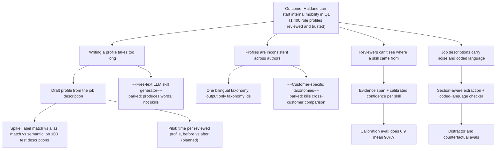

# Opportunity solution tree

Outcome first, then the opportunities the interviews surfaced, then candidate solutions, then the experiment that tests each one. Crossed-out branches were considered and parked, with the reason.

| Opportunity | Evidence it is real | Size (illustrative) | Chosen solution | Test |
|---|---|---|---|---|
| Writing takes too long | I3: ~45 min per role; 1,400 roles | ~1,050 consultant hours | Draft profile | Pilot H3 ([hypotheses](hypotheses.md)) |
| Inconsistent vocabulary | I3, I6 | every profile | Taxonomy-grounded output | Spike: A vs B |
| No "why" | I1, I3, I6 | every review | Evidence + confidence | Evidence accuracy, ECE |
| Noise in job descriptions | I2, I4 | ~1 in 2 descriptions has a distractor | Sections, negation, company voice | Distractor rate |
| Coded language | I2 | ~1 in 5 descriptions (generated set) | Lexicon checker | Checker recall, false alarms |
