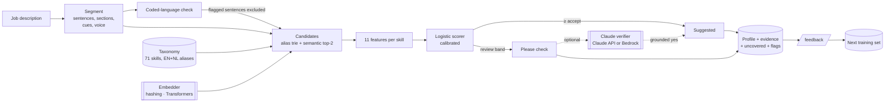

# Technical design: SkillDraft v1

*RFC style. Status: accepted for the Haldane pilot. Author: AI product engineer. Reviewers: PM, staff engineer, data protection officer.*

## Context

HR business partners need reviewed skill profiles for 1,400 roles ([problem brief](../00-discovery/problem-brief.md)). The spike showed that a taxonomy-grounded, structure-aware extractor with a calibrated score beats a naive one by a wide margin ([spike report](../01-prototype/spike-report.md)). This document describes the service that ships.

## Goals and non-goals

**Goals:** draft profile per job description with taxonomy ids, importance, confidence and evidence; review band; feedback capture; coded-language flags; EN and NL; p95 < 250 ms in process; deterministic.

**Non-goals (v1):** employee skill inference, automated shortlisting, French, a UI beyond the demo, multi-tenant taxonomy customisation.

## Design

### Components

| Component | File | Responsibility | Swappable? |
|---|---|---|---|
| Text | `skilldraft/text.py` | Folding with stable offsets, sentences, sections, cues, negation scope, voice | No (core) |
| Taxonomy | `skilldraft/taxonomy.py` | Load, alias trie, longest match, search | Store can change (JSON → DB) |
| Embedder | `skilldraft/embed.py`, `adapters/hf_embedder.py` | `fit / encode / similarity` | Yes, by interface |
| Pipeline | `skilldraft/pipeline.py` | Candidates, features, decisions, evidence, importance, uncovered sentences | Configs A–D for evals |
| Scorer | `skilldraft/scorer.py`, `training/train_torch.py` | Logistic model, thresholds, versioning | Trainer: stdlib or PyTorch |
| Verifier | `skilldraft/llm.py` | Judge the review band, schema-constrained, grounded quotes | Platform: Claude API or Bedrock |
| Checker | `skilldraft/inclusive.py` | Coded wording with suggestions | Lexicon versioned with the taxonomy |
| Match | `skilldraft/match.py` | Rank people, gaps, close-to-learn | Phase 2, behind a flag |
| API | `skilldraft/api.py` | HTTP, auth, limits, problem details, feedback | Framework can change; contract cannot |
| Obs | `skilldraft/obs.py` | JSON logs, metrics, spans | Exporter can change |

### Key decisions

[ADR index](../03-decisions/README.md). In short: output only taxonomy ids (0001); the LLM verifies and never invents (0002); calibrated score with a review band (0003); no skill without evidence (0004); standard-library core with optional heavy adapters (0005); Bedrock for EU customers (0006); evals are the release gate (0007); people decide (0008); sentences about personal traits are never evidence (0009).

## API

[OpenAPI 3.1 contract](openapi.yaml), checked against the routes by `tests/test_api.py`. Summary and examples: [api.md](api.md).

## Data

- **Taxonomy** `data/taxonomy.json`, versioned (`2026.10`). Each skill: id, label, family, aliases with language and ambiguity flag, definitions in EN and NL, related skills.
- **Model** `models/scorer.<embedder>.json`: weights, thresholds, embedder name, training set hash, version derived from the content.
- **Feedback** JSONL: request id, skill id, verdict, model version, time. No job description text, no user name.
- **Job descriptions are not stored** by the service. They pass through memory only.

## Alternatives considered

| Alternative | Why not (now) |
|---|---|
| LLM extracts skills directly, mapped afterwards | Different words per call; no evidence by construction; cost per description; free text cannot be calibrated per skill. Kept as the verifier. |
| Fine-tuned token classifier (NER) on job descriptions | Needs thousands of labelled spans we do not have; the feedback loop will produce them. Revisit after the pilot. |
| Fine-tuned bi-encoder for skills | The right next step for described skills, but this data set reuses one paraphrase per skill and language, so any sentence-level training would memorise the test set. Needs new held-out paraphrases or real data first ([EVIDENCE](../../EVIDENCE.md)). |
| Vector database for skills | 71 skills fit in memory; a brute-force dot product is microseconds. Revisit at ~50k skills. |
| Microservices (extractor, scorer, verifier) | One team, one deployable, one latency budget. Module boundaries are there; the network hop is not. |

## Rollout

Shadow mode on 40 Haldane descriptions, then a reviewer pilot with the feature flag on for two HR partners, then all of Haldane ([launch plan](../05-delivery/launch-plan.md)).

## Risks

[Risk register](../05-delivery/risk-register.md). The top three: described skills on real text (H2), reviewer trust after one bad suggestion (H4), and AI Act scope creep when matching moves to people ([ai-act.md](../04-quality/ai-act.md)).
